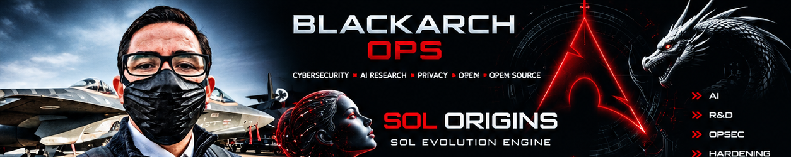

  

# `>_` BLACKARCH OPS

### Juan Favela

**Linux & Cybersecurity Research · Android Privacy · Local AI Development**

**Cybersecurity · Linux · Privacy · Reproducible Research**

---

## About

I'm **Juan Favela**, an independent builder working on Linux security, Android customization, privacy-preserving tooling, and experimental local AI under the **BLACKARCH OPS** identity.

My approach emphasizes reproducible methods, system hardening, careful documentation, recoverability, and clear distinctions between prototypes, proposed capabilities, and measured results.

## Selected Projects

| Project | Research / development focus | Current status |
| --- | --- | --- |
| **Termux Wallpaper** | Native wallpaper support in an independent Termux fork | MVP tested on an isolated Android emulator; not publicly released |
| **RuView** | Linux Wi-Fi signal analysis and experimental sensing | Research and development |
| **SOL Origins — SOL Evolution Engine** | Experimental local AI, contextual retrieval, restricted tools and state continuity | Working private prototype; benchmarks not yet publicly verified |
| **BlackArch Fortress / Sentinel** | Linux security auditing, policy hardening and controlled research workflows | Ongoing private research |

> Project descriptions do not imply source-code release or official affiliation. Public repositories and evidence will be linked after security, privacy and licensing review.

## Public repositories

| Repository | Focus |
| --- | --- |
| [BlackArch-Android](https://github.com/Sylviomanuel-netizen/BlackArch-Android) | Native Arch ARM chroot and encrypted storage |
| [RestlessOS-Moto-G-2025](https://github.com/Sylviomanuel-netizen/RestlessOS-Moto-G-2025) | Device-specific Android GSI research |
| [BlackArch-OPS-Dotfiles](https://github.com/Sylviomanuel-netizen/BlackArch-OPS-Dotfiles) | Linux desktop and terminal configuration |
| [GrapheneOS-Installation-Guide](https://github.com/Sylviomanuel-netizen/GrapheneOS-Installation-Guide) | Official WebUSB installation walkthrough |
| [GrapheneOS-Privacy-Guide](https://github.com/Sylviomanuel-netizen/GrapheneOS-Privacy-Guide.) | Mobile security and privacy education |
| [Whonix-Installation-Guide](https://github.com/Sylviomanuel-netizen/Whonix-Installation-Guide) | Tor networking and isolated virtual machines |

## Tech Stack & Interests

`BlackArch Linux` · `Arch Linux` · `Android` · `GrapheneOS` · `Termux` · `Python` · `Bash` · `Git` · `Docker` · `Ollama` · `Linux Security` · `OPSEC`

## Mission & engineering principles

I develop and investigate privacy-conscious Linux and Android tools, reproducible security workflows, and carefully evaluated local AI systems.

- **Evidence before claims:** distinguish experimental features from independently measured results.
- **Privacy and security:** safeguard private research data, configurations and system state.
- **Recoverability:** prioritize versioned encrypted backups and tested restoration.
- **Responsible open source:** respect upstream licenses, maintainers and disclosure boundaries.

## Support SOL Origins

**SOL Origins — Independent AI Research** is a personal, independently developed research project exploring locally run language models and experimental memory/tool workflows. A working private prototype exists; a dedicated research workstation and reproducible public evaluation are planned, not completed.

The fundraiser is personal, **not a registered charity**. Contributions are optional and do not purchase products or services.

[Visit the SOL Origins fundraising campaign](https://www.gofundme.com/f/help-build-sol-origins-independent-ai-research)

## Connect

**GitHub:** [@Sylviomanuel-netizen](https://github.com/Sylviomanuel-netizen)

**LinkedIn:** [Juan Favela](https://www.linkedin.com/in/juan-favela-4b2151254/)

---

BLACKARCH OPS is an independent project identity and is not affiliated with or endorsed by BlackArch, Termux, GrapheneOS or their maintainers.

